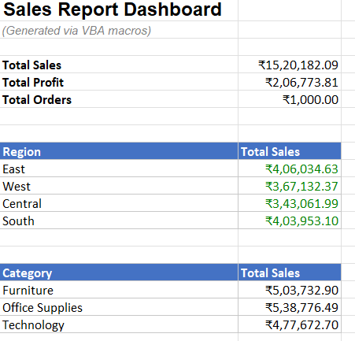
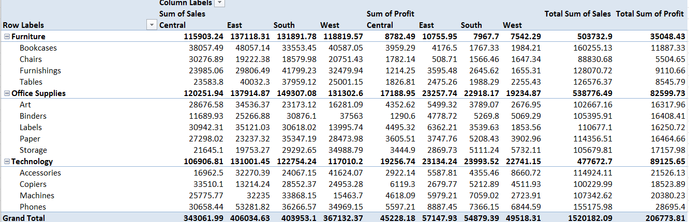
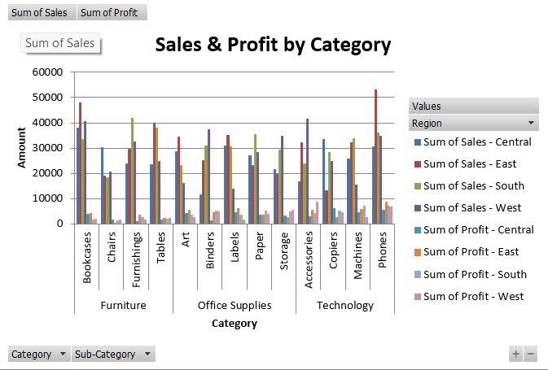

# 📊 Superstore Sales Dashboard (Excel VBA Automation)

## 📌 Project Overview

An **automated sales reporting system** built in Excel using **VBA macros**. With a single click, the macros clean the raw data, calculate KPIs, build a pivot table, create a chart and format the final dashboard.

The dataset has **1,000 orders** across 4 regions and 3 product categories.

## 🎯 Project Objectives

- Automate repetitive reporting work using VBA
- Clean raw sales data automatically (blank rows, extra spaces, duplicates)
- Summarize Total Sales, Total Profit and Total Orders
- Analyze sales by **Region**, **Category** and **Sub-Category**
- Build a pivot table and chart without any manual steps

## 🖼️ Dashboard Preview



## 📈 Pivot Table (Category > Sub-Category by Region)



## 📊 Sales & Profit by Category



## ⚙️ Automation (VBA)

All macros are in [`VBA_Code/Superstore_Report_Macros.bas`](VBA_Code/Superstore_Report_Macros.bas).

| Macro | What it does |
|-------|--------------|
| `CleanRawData` | Deletes blank rows, trims extra spaces from text, removes duplicate Order IDs |
| `GenerateSummary` | Calculates Total Sales, Total Profit, Total Orders, plus region-wise and category-wise sales using formulas (SUM, COUNTA, SUMIF) |
| `CreatePivotTable` | Builds a pivot table with Category and Sub-Category in rows, Region in columns, and Sum of Sales and Profit as values |
| `CreateChart` | Creates a clustered column chart "Sales & Profit by Category" from the pivot table |
| `FormatDashboard` | Applies header colours, number formats, borders and green/red font colouring |
| `GenerateFullReport` | Runs all the macros above in order with one click |

## 🔍 Key Insights

- 💰 **Total Sales: ₹15,20,182.09** | **Total Profit: ₹2,06,773.81** across **1,000 orders**
- 🌍 **East** region has the highest sales (₹4,06,034.63), followed by South and West
- 🏆 **Office Supplies** has the highest sales (₹5,38,776.49), while **Technology** earns the highest profit (₹89,125.65)
- 🪑 **Furniture** has the lowest profit (₹35,048.43) despite high sales

## 🛠️ Tools Used

- Microsoft Excel
- VBA (Macros)
- Pivot Tables and Pivot Charts
- Excel Formulas (SUM, SUMIF, COUNTA)

## 📁 Project Structure

```
superstore-sales-dashboard-vba/
├── EXCEL/
│   └── Superstore_Sales_Data.xlsm
├── VBA_Code/
│   └── Superstore_Report_Macros.bas
├── Screenshots/
│   ├── 01_Excel_Dashboard.png
│   ├── 02_Pivot_Table.png
│   └── 03_Sales_Profit_Chart.png
└── README.md
```

## ▶️ How to Use

1. Download `EXCEL/Superstore_Sales_Data.xlsm`
2. Open it and click **Enable Content / Enable Macros**
3. Press **Alt + F8**, select `GenerateFullReport` and click **Run**
4. The Dashboard sheet will be generated automatically

## 👩‍💻 Author

**Prabhleen Kaur**
B.Com (Hons) | Aspiring Data Analyst / MIS Executive
GitHub: [Prabhleenkaur100](https://github.com/Prabhleenkaur100)
